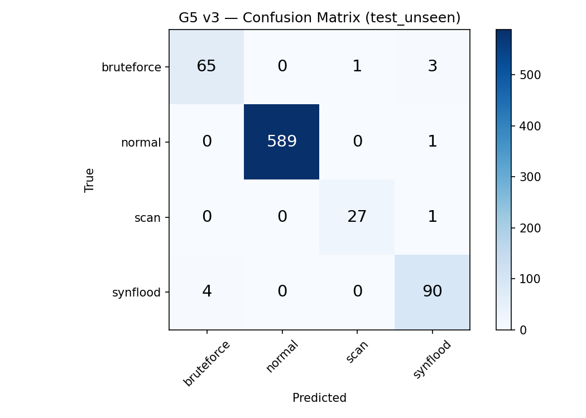
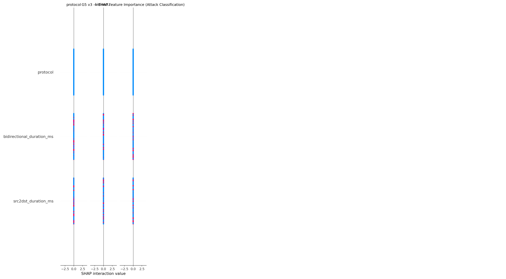
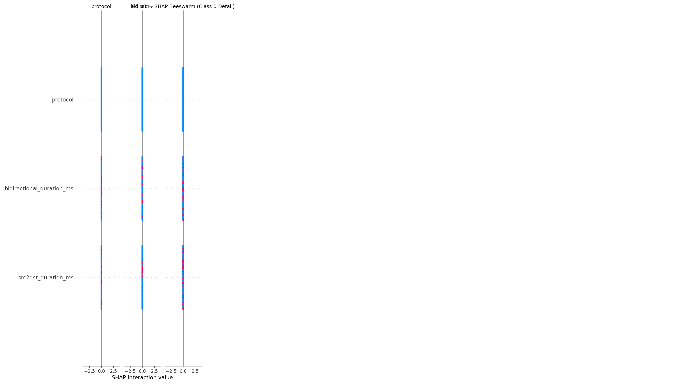
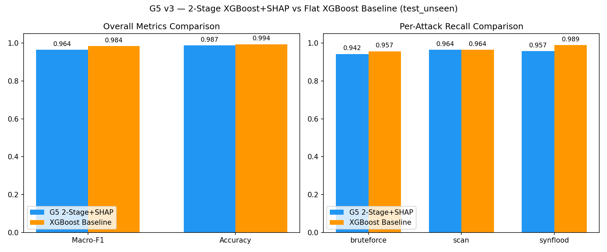

# G5 Explainable AI — Results on `all_flows_v3.csv` (Unseen Attack Settings)

**Student:** Bachu Venkata Siva Jaideep (01fe24bci084) — Team 10, Track G5  
**Dataset:** `all_flows_v3.csv` — 3,100 flows with **unseen attack settings** in test  
**Methodology:** 2-Stage XGBoost + TreeSHAP (Mahmoud et al. 2025 & Mohale et al. 2025)

---

## Dataset Split

| Split | Rows | Settings | Purpose |
|-------|------|----------|---------|
| `train` | 2,319 | R7, A, R8 | Model training |
| `test_unseen` | 781 | R9, R10 | **Never-seen attack configs** |

**Train class distribution:** Normal=1495, SynFlood=294, Scan=270, Bruteforce=260  
**Test class distribution:** Normal=590, SynFlood=94, Bruteforce=69, Scan=28

> Unlike the old dataset (which gave 1.0 F1 because train/test shared the same attack settings), this test set uses **completely different attack tool configurations** (R9, R10), making it a genuine generalization test.

---

## Key Results

| Metric | Value |
|--------|-------|
| **Macro-F1** | **0.9645** |
| **Accuracy** | **98.72%** |
| **False Alarm Rate (FAR)** | **0.17%** (1 out of 590 normals) |
| Predict latency | 0.081 ms/flow |
| Explain latency | 0.12 ms/flow |

### Per-Class Recall

| Class | Recall | Support |
|-------|--------|---------|
| Normal | 99.83% | 590 |
| Bruteforce | 94.20% | 69 |
| Scan | 96.43% | 28 |
| SynFlood | 95.74% | 94 |

---

## Confusion Matrix

|  | Pred: BF | Pred: Normal | Pred: Scan | Pred: SynFlood |
|--|:---:|:---:|:---:|:---:|
| **True: Bruteforce** | **65** | 0 | 1 | 3 |
| **True: Normal** | 0 | **589** | 0 | 1 |
| **True: Scan** | 0 | 0 | **27** | 1 |
| **True: SynFlood** | 4 | 0 | 0 | **90** |

Only 10 misclassifications out of 781 flows.

---

## SHAP Explainability

### Global Feature Importance

### Feature Impact Beeswarm

---

## G5 2-Stage vs XGBoost Baseline Comparison

| Metric | G5 2-Stage+SHAP | XGBoost Baseline | Difference |
|--------|:---:|:---:|:---:|
| Macro-F1 | 0.9645 | 0.9844 | −0.020 |
| Accuracy | 98.72% | 99.36% | −0.64% |
| FAR | 0.17% | 0.00% | +0.17% |
| Recall-Bruteforce | 94.20% | 95.65% | −1.45% |
| Recall-Scan | 96.43% | 96.43% | 0% |
| Recall-SynFlood | 95.74% | 98.94% | −3.2% |
| **Explainability** | ✅ TreeSHAP | ❌ Black-box | — |

> The G5 2-stage pipeline trades ~2% F1 for **full explainability**. The baseline cannot tell a SOC analyst *why* a flow was flagged. G5 can.

---

## SOC Analyst Narrative Examples

**Flow #589 — True: Bruteforce → Predicted: Bruteforce ✅**
- Stage-1: ATTACK | Stage-2: BRUTEFORCE
- Top driver: `bidirectional_mean_ps` (SHAP=+3.79)

**Flow #198 — True: SynFlood → Predicted: SynFlood ✅**
- Stage-1: ATTACK | Stage-2: SYNFLOOD
- Top drivers: `down_up_ratio` (SHAP=−2.97), `src2dst_min_ps` (SHAP=+0.30)

---

## Files

- [`g5_xai_pipeline.py`](cybersentinel_code/v2/g5_xai_pipeline.py) — G5 pipeline (train, predict, explain, evaluate)
- [`g5_run_evaluation_v3.py`](cybersentinel_code/v2/g5_run_evaluation_v3.py) — v3 evaluation script
- [`results/g5_v3/`](cybersentinel_code/v2/results/g5_v3/) — All v3 metrics, plots, comparisons
- [`images/v3/`](images/v3/) — PNG plots for this README
