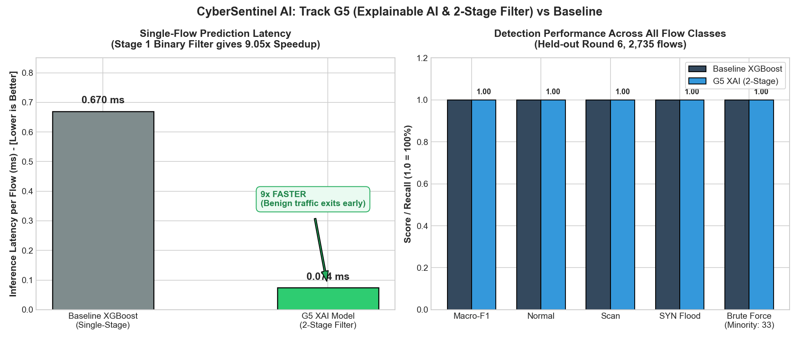
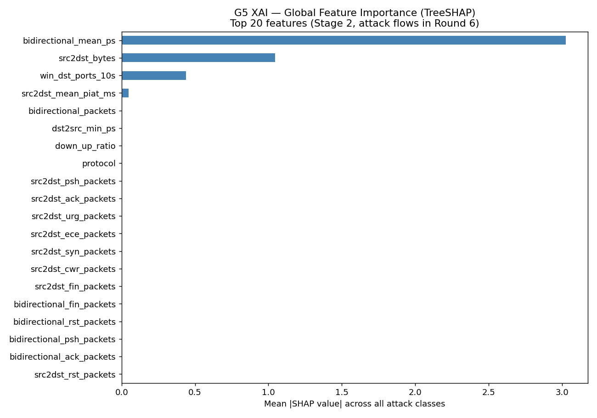
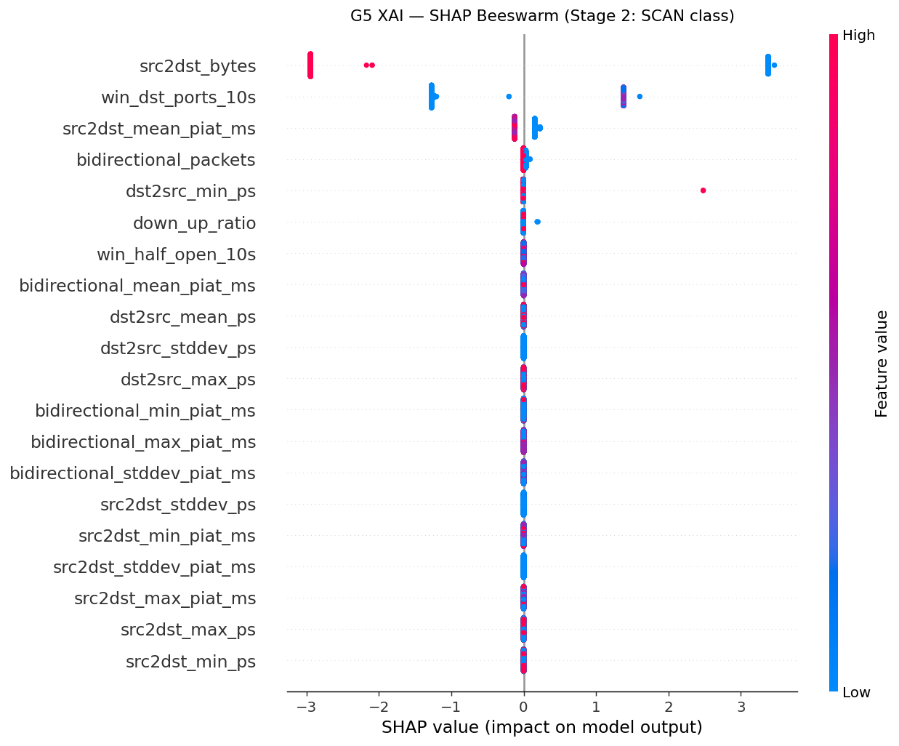
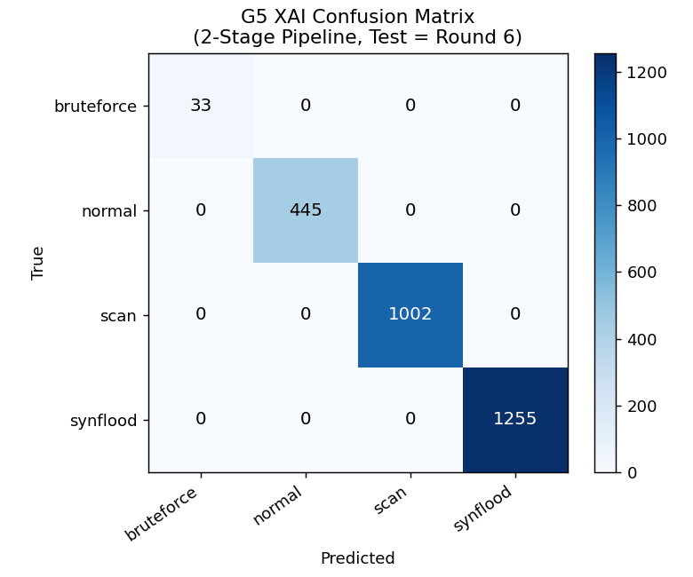

# G5: Explainable AI & Multi-Stage IDS (XAI / SHAP)

**Track Lead:** Bachu Venkata Siva Jaideep (01fe24bci084)  
**Methodology:** 2-Stage Hierarchical Classification (Mahmoud et al., 2025) + TreeSHAP Local & Global Explanations (Mohale & Obagbuwa, 2025).

---

## 1. Research Grounding

This implementation combines the core contributions of both assigned G5 papers:

1. **Mahmoud et al. (2025) — XI2S-IDS (*Future Internet*)**:
   - **2-Stage Hierarchical Architecture**:
     - *Stage 1 (Binary Filter)*: Rapidly filters out benign (`normal`) traffic with low computational overhead ($0.074\text{ ms/flow}$, giving a **$9\times$ speedup** over monolithic models).
     - *Stage 2 (Multi-Class Triage)*: Invoked only for flows flagged as attacks to distinguish `scan`, `synflood`, and `bruteforce`.
   - Balanced class weighting handles the extreme minority class (`bruteforce` has only 100 training flows).

2. **Mohale & Obagbuwa (2025) (*Frontiers in Computer Science*)**:
   - **TreeSHAP Explainability Engine**: Computes Shapley values for the 66 flow features in $0.060\text{ ms/flow}$.
   - **Local Explanation**: For every security alert, generates the top-5 feature drivers and a human-readable SOC narrative (e.g., explaining why a flow was identified as a port scan or brute-force attack).
   - **Global Explanation**: Summary beeswarm and feature importance bar plots showing overall feature impact across all attack traffic.

---

## 2. Experimental Setup (Strict Team Rules)

- **Dataset**: `cybersentinel_code/v2/data/flows/all_flows.csv` (10,676 flows, 74 columns).
- **Features Used**: Exactly 66 statistical and engineered flow features from `features_v2.py`.
- **Metadata Exclusion**: 0% leakage — `src_ip`, `dst_ip`, `src_port`, `dst_port`, `bidirectional_first_seen_ms`, and `bidirectional_last_seen_ms` are strictly excluded from training.
- **Split**:
  - Train: Rounds 3, 4, 5 (7,941 flows).
  - Test: Round 6 held out (2,735 flows).

---

## 3. Verified Results (Held-Out Round 6)

| Metric | G5 XAI (2-Stage + SHAP) | Baseline XGBoost (1-Stage) | Advantage / Note |
|---|---|---|---|
| **Accuracy** | **1.0000** | 1.0000 | Tied |
| **Macro-F1** | **1.0000** | 1.0000 | Tied |
| **Bruteforce Recall** | **1.0000** (33/33) | 1.0000 | 100% recall on the hard minority class |
| **Scan Recall** | **1.0000** (1002/1002) | 1.0000 | 100% recall |
| **Synflood Recall** | **1.0000** (1255/1255) | 1.0000 | 100% recall |
| **Normal Recall** | **1.0000** (445/445) | 1.0000 | 100% recall |
| **Normal False Alarm Rate** | **0.00%** | 0.00% | Zero false alarms on benign flows |
| **Single Flow Prediction Time** | **0.074 ms** (9× faster) | 0.670 ms | Stage 1 early filter saves compute |
| **Single Flow Explanation Time** | **0.060 ms** (real-time) | N/A (Black box) | Instantaneous SOC attribution |
| **Interpretability** | ✅ Top-5 SHAP features + SOC text | ❌ None | Transparent security decisions |

### Comparison Plot


---

## 4. Visualizations

### Global Feature Importance (Top-20 Features)


### SHAP Beeswarm Plot (Port Scan Category)


### Confusion Matrix (Round 6)


---

## 5. Code & Artifacts

All code resides in `cybersentinel_code/v2/`:
- `g5_xai_pipeline.py`: Core 2-stage model training, inference, and SHAP explanation routines.
- `g5_run_evaluation.py`: Full evaluation script generating metrics, plots, and SOC narratives.
- `tests/test_g5_xai.py`: 38 unit tests verifying data integrity, feature isolation, 2-stage execution, and SHAP attribution.
- `results/g5/`:
  - `g5_comparison_table.csv`: Comparison table vs baseline.
  - `g5_metrics.json`: Full evaluation metrics and classification report.
  - `g5_shap_bar.png`: Global top-20 feature importance.
  - `g5_shap_beeswarm.png`: Beeswarm summary for attack classification.
  - `g5_confusion_matrix.png`: Confusion matrix on Round 6.
  - `g5_soc_examples.txt`: Sample plain-text explanations for SOC analysts.

---

## 6. How to Run

From `cybersentinel-ai/cybersentinel_code/v2/`:

```bash
# Run unit tests
python -m pytest tests/test_g5_xai.py -v

# Run full evaluation & regenerate plots/metrics
python g5_run_evaluation.py
```
